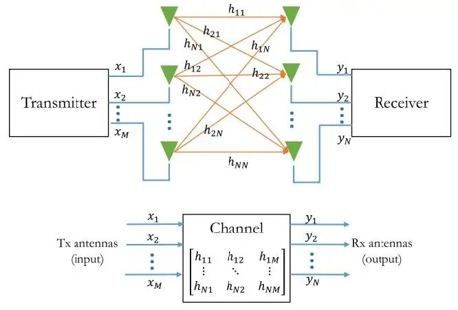
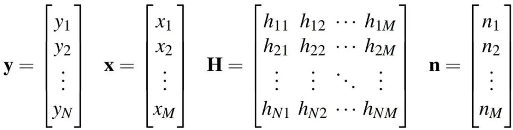
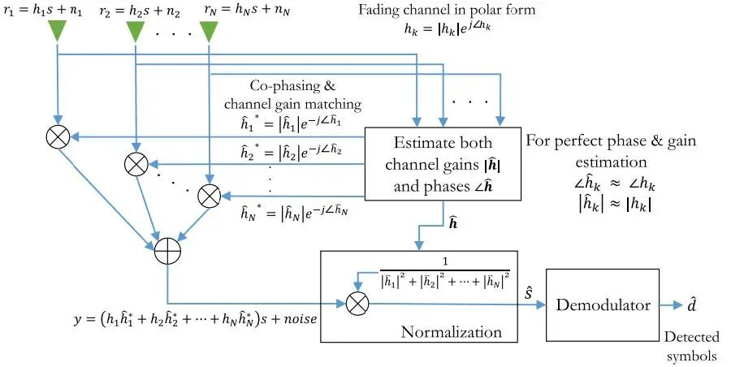
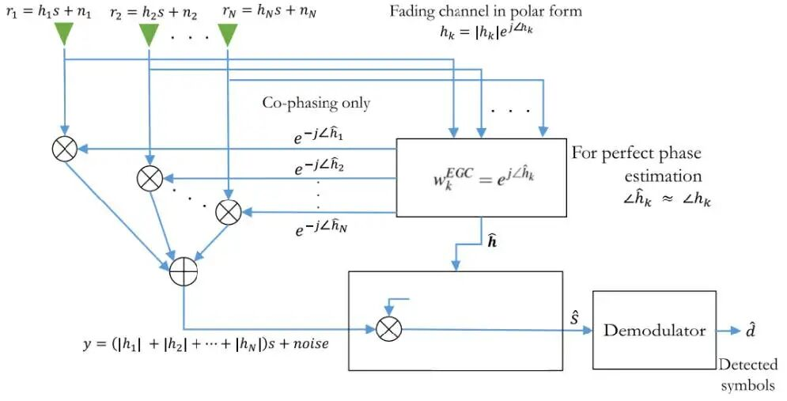
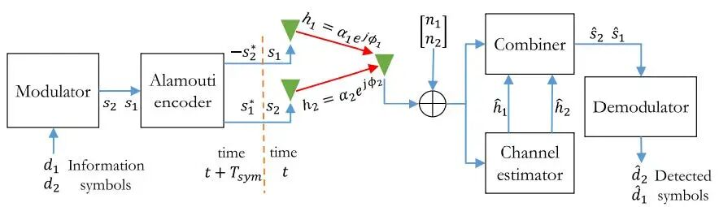
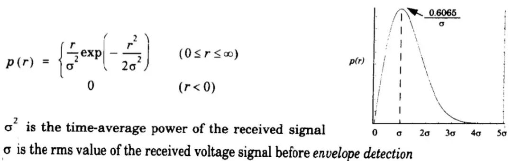
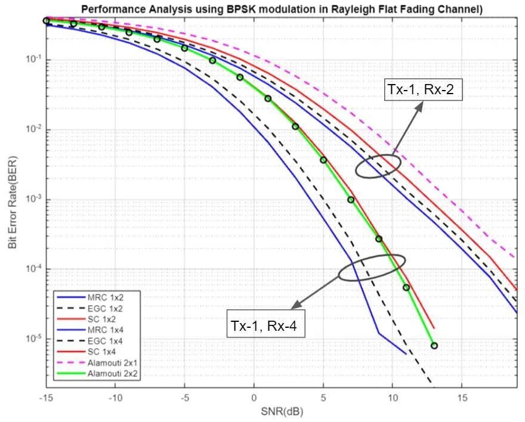

# [MIMO+Rayleigh]Analysis of MIMO System Performance in Rayleigh Flat Fading Channels Using Various Schemes [with MATLAB Code]

The use of diversity techniques allows communication systems to be robust and reliable even under different channel conditions. Diversity techniques exploit channel variations rather than mitigating them. Diversity techniques prevent fading and interference by providing multiple uncorrelated copies of the same information-carrying signal to the receiver. Essentially, diversity techniques aim to create uncorrelated random channels, thereby creating uncorrelated copies of the same signal at the receiver's front end. The receiver employs combining techniques to leverage the multipath propagation characteristics of the channel. In broad terms, the term diversity can be divided into: time diversity, frequency diversity, spatial diversity (antenna diversity), polarization diversity (antenna diversity), etc. For spatial diversity, to create uncorrelated propagation paths for a signal, spatial diversity is achieved through the use of multiple antennas at both the transmitter and/or receiver. Using multiple antennas at the transmitter is known as transmit diversity, while using multiple antennas at the receiver is known as receive diversity. The receiver can utilize diversity combination techniques such as Selective Combiner (SC), feedback or scanning combiner, maximum ratio combiner (MRC) to exploit the multipath effect. Spatial diversity technology can also be used to improve data rate (space-multiplexing) instead of enhancing channel reliability. MIMO and space-time block coding (STBC) can serve as examples.
A MIMO system can be modeled in the following way:
System configuration typically includes M antennas on the transmitter and N antennas on the receiver front end, as shown in the diagram above. This is a multi-input multi-output (MIMO) channel model. Each receiver antenna receives not only the direct signal prepared for it but also a small portion of signals from other propagation paths. Therefore, the channel response is represented by the transmission matrix H. The line formed between the transmitter's antenna 1 and the receiver's antenna 1 represents the path through the channel response h11. The path formed between the transmitter's antenna 1 and the receiver's antenna 2 represents the channel response h21, and so on. Thus, the dimension of the channel matrix is N ×M. The received vector y is expressed as y = Hx + n; where various symbols are located at 
For non-symmetric antenna configurations (M6 = N), the number of data streams (or uncoupled equivalent channels) in the system is always less than or equal to the minimum value of min(M, N). 
In mobile wireless systems, the envelope of the received signal consists of superposition of slow and fast fading components. Slow fading is caused by the rough changes in terrain between the mobile station and the base station. Fast fading is caused by the interference between multipath waves scattered from surrounding scatterers. Spatial diversity techniques are used to combat the effects of fast and deep fading. In spatial diversity techniques, the same information is transmitted through independent uncorrelated channels to combat fading. When multiple copies of the same data are transmitted through independent fade-resistant channels, the amount of fade experienced by each copy will be different. This ensures that at least one copy has a lower degree of fade compared to others. At the receiver, signals from independent propagation paths are combined, thus increasing the chances of correctly receiving the transmitted data. In practice, this improves the reliability of the entire system. MRC, EGC, SC, and Alamouti schemes can be used in MIMO systems to provide spatial diversity.
MRC combines all signals in a coherent and weighted manner to ensure the highest achievable SNR at the receiver. The working process of MRC is shown in the following figure:
Although MRC provides the best average SNR at the output, its implementation has a very high computational complexity.
EGC alleviates this issue by combining all signals with unit weights corresponding to all signal levels in a coherent manner, ensuring the highest achievable SNR at the receiver. This reduces computational complexity and results in slightly lower SNR at the receiver side. The working process of EGC is shown in the following figure:
In SC technology, the best signal is selected from all signals received from different branches at the receiver. This is a very simple implementation technique. However, in this case, compared to MRC and EGC, the average received SNR is worse, while MRC and EGC become significant enough in higher diversity branches.
The Alamouti Scheme is a coding technique that does not require any feedback from the receiver or any bandwidth expansion. Its computational complexity is similar to that of the MRC receiving diversity technique, with one transmit antenna and two receive antennas. The working process of the Alamouti Scheme is shown in the following figure:
The Rayleigh Flat Fading Channel model describes the statistical time-varying nature of wireless signals with flat fading when line-of-sight (LOS) is absent. In this channel model, the Rayleigh distribution provides the received voltage envelope as follows:
In this project, we use a Rayleigh Flat Fading Channel with BPSK modulation to simulate MIMO systems. We then analyze the performance of MRC, EGC, and SC under Tx-1, Rx=2 (L=2) & Tx-1, Rx=4 (L=4), Alamouti 2x1 (L=2) & Alamouti 2x2 (L=4) by plotting BER vs SNR graphs.
The system was simulated using MATLAB. Firstly, 106 bits were randomly generated as transmit symbols. The SNR ranged from -15dB to +20dB with an increment of 2dB. These bits were modulated with BPSK and then transmitted through a Rayleigh Flat Fading Channel. Assuming that the signal energy of each transmitted bit is equal. For each SNR, the Rayleigh fading gain was applied, and AWGN noise was added to the Tx signal to generate the received signal. At the receiver side, perfect channel estimation was assumed. The simulation was conducted based on the numbers shown above. After bit detection, the bit error rate (BER) was calculated by comparing the received bits with the transmitted ones. Then, all BER values were plotted against the SNR values.
The results of the BER vs SNR relationship graphs for different simulations are as follows:
Conclusions can be drawn from the BER vs SNR relationship graphs that all systems have better BER performance in the following order:
MRC-1x4 > EGC-1x4 > Alamouti-2x2 ≈ SC-1x4 > MRC-1x2 > EGC-1x2 > SC-1x2
MRC, EGC-1x4 performs better than Alamouti-2x2, despite having the same diversity L=4, as they assume that each bit's energy is equal. Alamouti-2x2 uses 2 transmit antennas, ultimately dividing the energy of each signal replica by a factor of 2. Therefore, compared to MRC and EGC, the received SNR for Alamouti is smaller. MRC, EGC-1x2, and Alamouti-2x1 also experience this issue, although they have the same L=2 diversity. Alamouti-2x2 and SC-1x4 initially show equivalent BER and SNR performance, but as SNR increases, Alamouti outperforms SC.

## Images

<!-- PAYMENT_BLOCK -->

## Get this dataset

- Payment link (Stripe): [Buy now](https://buy.stripe.com/3cs8yP7sY87d0vu9AB)
- Payment QR code: 

<!-- /PAYMENT_BLOCK -->
